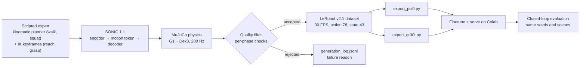

# Ψ₀ vs GR00T N1.7 on a Unitree G1: walk around an obstacle, squat, pick, place

This repo compares two vision-language-action models, [Ψ₀ (Psi0)](https://github.com/physical-superintelligence-lab/Psi0)
and [NVIDIA GR00T N1.7](https://github.com/NVIDIA/Isaac-GR00T), on a loco-manipulation task with a Unitree G1 humanoid
(Dex3 hands) in MuJoCo:

> Walk around the box in front of you to the low stand, squat down, pick up the can from the stand with your right hand,
> stand up, walk to the table, put the can in the tray on the table, then return to the home pose.

Both models drive the whole body through NVIDIA's **SONIC 1.1** whole-body controller. They output the same action:
a 64-D SONIC motion token for the body plus 14 hand joints. The repo contains everything around the models: a scripted
expert that generates demonstrations, exports to both models' dataset formats, Colab notebooks for finetuning and
serving, and a closed-loop evaluation harness.

The current task is [`can_nav_pnp`](scripts/datagen/can_nav_pnp/README.md). The full design log, with every approach that
was tried and the numbers behind each decision, is in
[docs/sonic_pick_can/06_memo_can_nav_pnp.md](docs/sonic_pick_can/06_memo_can_nav_pnp.md) (Vietnamese).

## Status (2026-10-14)

| Step | Status |
| --- | --- |
| `can_nav_160`: 160 episodes, obstacle in the centre, detour on the left | Done, exported for Ψ₀ and GR00T |
| Ψ₀ finetuned on `can_nav_160` (run `cannav160-s11`, 8,000 steps) | Done |
| GR00T N1.7 finetuned on `can_nav_160` | Not run yet (notebook ready) |
| Closed-loop evaluation of Ψ₀ ckpt 8000 | 2 successes in the first 3 valid scenes; 10-scene run on Colab in progress |
| 340 more episodes with a randomized obstacle (`--level 1`), generated on Colab | Generated; not merged yet |
| Merge to 500 episodes, export, retrain both models, compare | Next |

## How it works



- **Expert.** SONIC's kinematic planner (`planner_sonic.onnx`, trained with the MotionBricks code) produces the walking
  and squatting references. Reaching, grasping and placing use IK keyframes. SONIC tracks these references in physics,
  so every recorded action is a real SONIC token.
- **Filtering.** Only clean episodes are kept. Every attempt, with its rejection reason and per-phase diagnostics, goes
  to `meta/generation_log.jsonl`. Physics runs headless; accepted episodes are rendered afterwards from their recorded
  states, so rejected attempts cost no rendering.
- **One dataset, two models.** Both exports use the same validation episodes, so the models are trained and validated on
  identical data.

## Main findings so far

- **Re-anchor the scene to where the robot actually stops.** SONIC stops and places its feet only to within about ±5 cm,
  while the grasp needs the can within ±1.5 cm. Once the robot has settled, the stand, can, table and tray are moved by
  the rigid transform from the nominal to the actual stance. They are static and far from the path, so this is equivalent
  to having placed them there from the start (verified by replaying recorded actions in the final layout).
- **Square the feet before squatting.** After walking, SONIC stands with the toes splayed (+10° / −20°), and squatting from
  that stance makes the feet slip. The expert now steps each foot back to the nominal stance first.
- **Expert success rate: 1/15 → 9/18 → 14/18 (78%)** across the three pilots that introduced these changes. With the
  randomized obstacle and `--level 1` it is 18/40 (45%), mostly from missed grasps.
- **Always face forward.** Turning the body along the path made the right hand brush the obstacle; walking sideways while
  facing +x keeps 7–15 cm of clearance.
- **SONIC 1.1 cannot squat fully.** The lowest pelvis height is about 0.42–0.47 m (0.76 m standing). Commanding deeper
  only lifts the heels. Picking an object off the floor would need SONIC itself to be finetuned, so the can sits on a
  low stand.
- **The detour side is inferred from the image.** The robot goes around the wider side of the obstacle, with the same
  instruction every time. Left/right instructions and random choices without a visual cue were rejected: the model
  could average both directions and walk into the obstacle.

## A fair comparison

| | Ψ₀ | GR00T N1.7 |
| --- | --- | --- |
| Data and validation split | same episodes | same episodes |
| Action | `action.body_token` 64 + hands 14 | `action` 78: `motion_token` 64, `left_hand_joints` 7, `right_hand_joints` 7 |
| State | 43 (joint order 0810) | 46 = 43 + projected gravity 3 |
| Camera | head camera, 320×240 | head camera, 320×240 |
| Effective batch / steps | 128 / 8,000 | 128 / 8,000 |
| Everything else | Ψ₀ recipe defaults | GR00T `finetune.sh` defaults |
| Evaluation | same seeds (from 1,000,000), same scenes, `--exec-steps 15` | same |

Only the step count and effective batch size are matched; learning rate, augmentation and the other settings stay at
each model's own defaults.

## Repository layout

```
scripts/datagen/can_nav_pnp/  current task: data generation (local / Colab), Ψ₀ + GR00T export, notebooks, evaluation
scripts/datagen/can_pnp/      earlier task: squat and pick a can off a low stand (SONIC 1.1)
scripts/datagen/box_pnp/      first task: pick a box off a pedestal
docs/sonic_pick_can/          design notes, pipeline, pilot reports, memos (Vietnamese)
```

The repo only contains these additions. It runs inside a checkout of the original Psi0 repo.

## Setup (Ubuntu)

```bash
git clone https://github.com/physical-superintelligence-lab/Psi0.git
cd Psi0
git checkout 4f3720d45e102b36d7c3e9465ab8062274170518
git submodule update --init third_party/GR00T-WholeBodyControl
git -C third_party/GR00T-WholeBodyControl lfs pull     # G1 model (MJCF), SONIC ONNX files
# SONIC 1.1 -> gear_sonic_deploy/policy/sonic_v1_1/
(cd third_party/GR00T-WholeBodyControl && python download_from_hf.py --sonic-v1-1)

# copy this repo's folders into the same places
git clone https://github.com/ThanhHungtaptanhhocpython/Psi0---Gr00tn1.7-.git /tmp/psi0-g1
cp -r /tmp/psi0-g1/scripts/datagen scripts/
mkdir -p docs && cp -r /tmp/psi0-g1/docs/sonic_pick_can docs/

# Python 3.11 environment for data generation and evaluation (uv; the venv has no pip)
curl -LsSf https://astral.sh/uv/install.sh | sh     # if uv is missing
uv venv --python 3.11 .venv-datagen
uv pip install --python .venv-datagen/bin/python mujoco==3.14.0 onnxruntime==1.30.0 numpy imageio imageio-ffmpeg \
    pandas pyarrow pillow scipy matplotlib
# only for evaluating GR00T (closed_loop_eval.py --gr00t)
uv pip install --python .venv-datagen/bin/python pyzmq msgpack
```

Run the commands from the repo root. On a machine without a display, prefix them with `MUJOCO_GL=egl` (GPU) or
`MUJOCO_GL=osmesa` and leave out `--viewer`.

## Quick start

```bash
# 1. pilot: success rate of the expert (physics only, nothing written but the attempt log)
.venv-datagen/bin/python scripts/datagen/can_nav_pnp/generate.py --out .data/can_nav_pilot --dry-run \
    --num-episodes 6 --max-attempts 6 --seed-start 900000 --threads 2
.venv-datagen/bin/python scripts/datagen/can_nav_pnp/summarize_log.py .data/can_nav_pilot

# 2. generate (shard by seed range, below 1,000,000) and merge; or run_blocks.py / colab_datagen.ipynb on Colab
.venv-datagen/bin/python scripts/datagen/can_nav_pnp/generate.py --out .data/can_nav_s0 --num-episodes 32 --seed-start 0 --threads 2
.venv-datagen/bin/python scripts/datagen/can_nav_pnp/merge_shards.py --out .data/can_nav_160 .data/can_nav_s0 ...

# 3. export for both models (same --seed -> same validation episodes)
.venv-datagen/bin/python scripts/datagen/can_nav_pnp/export_psi0.py  .data/can_nav_160 --out .data/psi0  --zip
.venv-datagen/bin/python scripts/datagen/can_nav_pnp/export_gr00t.py .data/can_nav_160 --out .data/gr00t --zip

# 4. finetune and serve on Colab (notebooks in scripts/datagen/can_nav_pnp/), then evaluate closed loop
.venv-datagen/bin/python scripts/datagen/can_nav_pnp/closed_loop_eval.py --server http://HOST:PORT --episodes 10
.venv-datagen/bin/python scripts/datagen/can_nav_pnp/closed_loop_eval.py --gr00t HOST:PORT --episodes 10
```

Every step, option and notebook is described in [scripts/datagen/can_nav_pnp/README.md](scripts/datagen/can_nav_pnp/README.md).

## Earlier tasks

- **`box_pnp`**: pick a box off a pedestal and place it in the tray. A Ψ₀ checkpoint finetuned for about 8,000 steps on
  126 episodes succeeded in **1/10** unseen scenes, with most failures at the grasp. That dataset was generated with
  SONIC 1.0 and needs to be regenerated with 1.1.
- **`can_pnp`**: squat, pick a can off a low stand, walk to the table and place it in the tray. It requires SONIC 1.1,
  because 1.0 does not lower the body and arms far enough. See [scripts/datagen/can_pnp/README.md](scripts/datagen/can_pnp/README.md).

## Notes

- **State order (43):** legs 12, waist 3, left arm 7, right arm 7, left hand 7, right hand 7. `export_psi0.py` permutes
  the MJCF `qpos[7:50]` by joint name. The state descriptions in `docs/sonic_pick_can/01` and `02` predate a re-check;
  where they differ, trust the code.
- **Grasp assist:** the Dex3 model cannot hold an object on its own, so a soft weld attaches it once the fingers make
  contact. It is used both for data generation and evaluation.
- **SONIC version:** SONIC 1.1 (`sonic_v1_1`) is the default (`SONIC_VARIANT`). `meta/info.json` records
  `sonic_version`; the data, the finetuned checkpoint and the decoder used for evaluation must all match.

## Credits

`box_pnp` and the first version of `can_pnp` were written by Nguyen Duy Hoang ([ndhoang2k5/psi0](https://github.com/ndhoang2k5/psi0)).
Psi0 and GR00T-WholeBodyControl code is under the licenses of their own repos.
