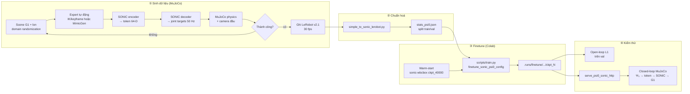
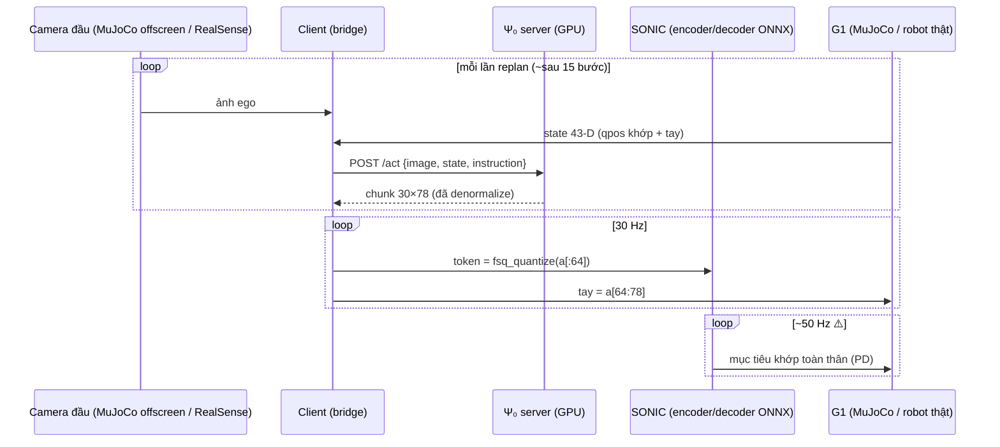

# Luồng pipeline Ψ₀ + SONIC: từ dữ liệu MuJoCo tự sinh đến finetune và kiểm thử

> Tài liệu 1/2: **mô tả luồng** (kiến trúc, cách Ψ₀ ghép với SONIC, định dạng dữ liệu đầu vào, luồng sinh dữ liệu, luồng finetune và kiểm thử).
> Tài liệu 2/2: [02_ke_hoach_thiet_ke_finetune_kiem_thu.md](02_ke_hoach_thiet_ke_finetune_kiem_thu.md) chứa **kế hoạch thực thi**, các cell Colab và tiêu chí nghiệm thu.
>
> Task mục tiêu: robot Unitree G1 **cúi xuống nhặt một cái lon trên sàn rồi đứng dậy** (whole-body loco-manipulation), điều khiển bởi Ψ₀ (VLA) + SONIC (whole-body controller).
>
> Quy ước:  đường dẫn tương đối tính từ gốc repo. Mục có ký hiệu ⚠️ là **chưa kiểm chứng được trong repo này**, vì hai submodule `third_party/SIMPLE` và `third_party/GR00T-WholeBodyControl` chưa được checkout. Phải xác minh ở Phase 0 của kế hoạch.

---

## 0. Bức tranh tổng thể



Ba tầng điều khiển của hệ thống:

| Tầng | Thành phần | Tần số | Vào → Ra |
|---|---|---|---|
| System-2 | Qwen3-VL-2B (VLM) | mỗi lần replan | ảnh + câu lệnh → đặc trưng ngữ nghĩa |
| System-1 | Action expert (MM-DiT, flow matching) | chunk 30 bước (1 s @30 fps) | đặc trưng VLM + state → chunk action 30×78 |
| System-0 | **SONIC** (RL whole-body tracking policy) | ~50 Hz ⚠️ | token 64-D (+ tay) → mục tiêu khớp toàn thân |

---

## 1. Kiến trúc Ψ₀

Nguồn: [src/psi/models/psi0.py](../../src/psi/models/psi0.py), [src/psi/config/model_psi0.py](../../src/psi/config/model_psi0.py), [src/psi/trainers/finetune.py](../../src/psi/trainers/finetune.py).

### 1.1 Các khối chính

`Psi0Model` ([psi0.py:1671](../../src/psi/models/psi0.py#L1671)) gồm 2 phần:

1. **`vlm_model`**: `Qwen3VLForConditionalGeneration` (Qwen3-VL-2B-Instruct). Có 28 layer, hidden 2048. Vì vậy các recipe đặt `--model.view_feature_dim=2048`.
2. **`action_header`**: `ActionTransformerModel`, một transformer joint-attention kiểu MM-DiT/SD3 ([psi0.py:1692-1711](../../src/psi/models/psi0.py#L1692-L1711)). Hidden 1536, 24 head × 64.
   - Mặc định có 6 block (khoảng 0.5B tham số).
   - Recipe "2.8B" dùng 12 block, mỗi block đọc một layer VLM riêng (khoảng 1B tham số).

### 1.2 Forward khi train (flow matching)

```
ảnh RGB 240×320 ─► Qwen3-VL (output_hidden_states) ─► 29 × (B, L, 2048)
                                                       │ chọn layer cuối
                                                       │ (hoặc vlm_layer_indices)
                                                       ▼
                                   views_proj Linear(2048→1536) ─► context tokens (B, L[+1], 1536)
state (B,1,43) ─► Linear(odim→1536) ─► +1 context token  (hoặc token 0 của action stream
                                                          nếu --model.state-as-action-token)
action nhiễu x_t (B,30,78) ─► ActionProjectionIn ─► (B,30,1536) + dec_pos
timestep σ·1000 ─► TimeNetwork (hoặc + CLIP pooled text nếu --model.combined-temb) ─► AdaLN
          ▼
   N × VLATransformerBlock (joint attention action ⟷ context, AdaLN-Zero)
          ▼
   ActionProjectionOut ─► vận tốc dự đoán v̂ (B,30,78)
```

- Nhiễu: σ ~ U(0,1), x_t = (1−σ)·a + σ·ε, target v = ε − a ([finetune.py:1002-1037](../../src/psi/trainers/finetune.py#L1002-L1037)).
- Loss: MSE × `actions_mask`, cộng theo trục thời gian rồi lấy trung bình. Trọng số giữa các chiều action là đều nhau (1/Da).
- Suy luận: Euler 10 bước từ 1000 xuống 0 ([psi0.py:1986-2010](../../src/psi/models/psi0.py#L1986-L2010)). Server SONIC dùng 8 bước.
- **RTC (real-time chunking)**: các checkpoint SONIC mới train với `--model.no-rtc` và dùng **test-time RTC** (`predict_action_with_rtc_flow`, guidance PiGDM, [psi0.py:2169](../../src/psi/models/psi0.py#L2169)) khi deploy. Lý do được ghi trong [examples/psi0_for_sonic.md](../../examples/psi0_for_sonic.md): cách này hồi phục lỗi tốt hơn.

### 1.3 Nạp trọng số warm-start

- `--model.model_name_or_path=<dir>` nạp VLM (thư mục kiểu HF, có `config.json` + `model.safetensors`).
- `--model.pretrained-action-header-path=<dir>` nạp `<dir>/action_header.safetensors`.
- **Quy tắc quan trọng** ([finetune.py:323-356](../../src/psi/trainers/finetune.py#L323-L356)):
  - Nếu `action_dim` hoặc `action_chunk_size` khác checkpoint, **chỉ `transformer_blocks.*` được nạp**. Các lớp projection vào/ra, `dec_pos`, `obs_proj` sẽ train lại từ đầu.
  - Vì vậy ta chọn checkpoint có **cùng 78-D / chunk 30** để nạp được toàn bộ.
- Một checkpoint lúc train (`.runs/.../checkpoints/ckpt_N/model.safetensors`, key phẳng `vlm_model.*` + `action_header.*`) **không** dùng trực tiếp làm warm-start được. Phải tách ra bằng [scripts/export_psi0_ckpt.py](../../scripts/export_psi0_ckpt.py).

### 1.4 Optimizer và bộ nhớ

- Có các nhóm AdamW riêng: `action_header`, `lang_backbone`, `vision_tower`, `mm_projector` ([finetune.py:443-506](../../src/psi/trainers/finetune.py#L443-L506)).
- `--model.no-tune-vlm`: VLM đóng băng và nạp ở bf16. Chỉ header được train. **Đây là lựa chọn phù hợp với Colab.**
- `--model.tune-vlm`: VLM nạp ở **fp32** (khoảng 32 GB/GPU), bắt buộc kèm `--model.gradient-checkpointing`. Batch 16 cần khoảng 71 GB nếu không có checkpointing ([finetune-real-sonic-psi0-2.8B-sonic1.1-robust.sh:11-14](../../scripts/train/psi0/finetune-real-sonic-psi0-2.8B-sonic1.1-robust.sh#L11-L14)).
- **flash-attn 2 là bắt buộc khi train**: `attn_implementation="flash_attention_2"` được hard-code ([finetune.py:273-277](../../src/psi/trainers/finetune.py#L273-L277)). Suy ra: GPU phải là Ampere trở lên (A100/L4), **không dùng được T4**. Chỉ lúc inference (`Psi0Model.from_pretrained`) mới tự fallback sang `sdpa`.

---

## 2. Ψ₀ kết hợp với SONIC như thế nào

### 2.1 SONIC là gì

SONIC (NVIDIA GR00T-WholeBodyControl, fork tại `third_party/GR00T-WholeBodyControl`) là một **behavior foundation model** cho humanoid, được train bằng RL để bám (tracking) chuyển động người. Nó gồm:

- **Encoder**: nén chuyển động tham chiếu (khoảng 10 frame tương lai, cách nhau 20 ms) thành **token latent 64-D**, lượng tử hoá FSQ.
- **Decoder/policy**: nhận token + proprioception, xuất mục tiêu khớp. Chạy khoảng 50 Hz, deploy bằng ONNX/TensorRT (`*_encoder.onnx`, `*_decoder.onnx`, `planner_sonic.onnx`).

Ý tưởng khi ghép với Ψ₀: **Ψ₀ không xuất trực tiếp góc khớp chân/thân, mà xuất token SONIC.** SONIC lo giữ thăng bằng và thực hiện chuyển động toàn thân. Nhờ vậy action của VLA gọn (64-D) và mang tính "ý định chuyển động" thay vì mô-men/khớp thấp tầng.

### 2.2 Không gian action và state

Có hai biến thể layout ([src/psi/config/transform_psi0_sonic.py](../../src/psi/config/transform_psi0_sonic.py)):

| Biến thể | Action (sau repack) | State | Dùng ở |
|---|---|---|---|
| **Neckless 78/43** (sim) | `[token 0:64 │ tay trái 64:71 │ tay phải 71:78]` | 43 | SIMPLE, `sonic-wbcbox` |
| Neck 80/45 (robot thật) | `[token 64 │ tay 14 │ cổ 2]` | 45 | G1 có cổ, checkpoint `postpre.sonic1.0...` |

**Task nhặt lon trong sim dùng layout 78/43.** State 43-D theo layout của SIMPLE ([simple_to_sonic_lerobot.py:16-18](../../scripts/data/simple_to_sonic_lerobot.py#L16-L18)):

```
observation.state (43) = [ left_leg 0:6 | right_leg 6:12 | waist 12:15 |
                           left_arm 15:22 | left_hand 22:29 | right_arm 29:36 | right_hand 36:43 ]
action nguồn (78)      = [ token 0:64 | left_hand 64:71 | right_hand 71:78 ]
```

- Token là FSQ 16 mức trên lưới `[-0.625, 0.625]`, bước `0.0625` ([mock_psi0_client_rtc.py:68-71](../../src/psi/deploy/mock_psi0_client_rtc.py#L68-L71)).
- Token ghi lại từ SONIC nằm **đúng trên lưới** này, còn Ψ₀ dự đoán giá trị liên tục. Vì vậy client **phải snap về lưới** (`fsq_quantize`) trước khi gửi cho SONIC.

⚠️ **Rủi ro thứ tự state**: các pack khác nhau dùng thứ tự state khác nhau (SIMPLE, teleop thật, psix). Checkpoint `sonic-wbcbox` được train trên layout SIMPLE ở trên, nên dữ liệu tự sinh **phải giữ đúng layout này**.

### 2.3 Vòng lặp runtime



- Server WebSocket RTC: [src/psi/deploy/serve_psi0_sonic.py](../../src/psi/deploy/serve_psi0_sonic.py).
  - Tự giữ đồng hồ 30 Hz (`CTRL_PERIOD_SEC=1/30`) và replan khi đã tiêu thụ `s_min=15` bước ([serve_psi0_sonic.py:65-69](../../src/psi/deploy/serve_psi0_sonic.py#L65-L69)).
- Server HTTP đơn giản (phù hợp cho sim/Colab): [src/psi/deploy/serve_psi0_sonic_http.py](../../src/psi/deploy/serve_psi0_sonic_http.py).
  - Là một wrapper mỏng của `serve_psi0_simple.Server`. `POST /act` trả chunk `(Ta, Da)` đã denormalize, có hỗ trợ `--rtc`.
- Client mẫu:
  - [src/psi/deploy/mock_psi0_client_sonic_http.py](../../src/psi/deploy/mock_psi0_client_sonic_http.py) replay một episode val và đo L1 cùng độ trễ.
  - [real/SONIC/psi0_vla_dex1_bridge.py](../../real/SONIC/psi0_vla_dex1_bridge.py) là bridge cho robot thật.
- ⚠️ Bước decode token thành khớp nằm trong SONIC (C++ `g1_deploy_onnx_ref` hoặc sim loop `gear_sonic/scripts/run_sim_loop.py`), **không có trong repo này**.

---

## 3. Ψ₀ nhận dữ liệu đầu vào để finetune như thế nào

### 3.1 Định dạng đĩa: LeRobot v2.1

```
<root_dir>/<repo_id>/
├── data/chunk-000/episode_000000.parquet      # 1 dòng = 1 frame @30 fps
├── videos/chunk-000/observation.images.egocentric/episode_000000.mp4
└── meta/
    ├── info.json          # fps, features, total_episodes/frames
    ├── episodes.jsonl     # {"episode_index", "tasks", "length"}
    ├── tasks.jsonl        # {"task_index", "task"}
    ├── modality.json
    ├── episodes_stats.jsonl
    ├── stats.json
    └── stats_psi0.json    # min/max/mean/std/q01/q99, dùng để chuẩn hoá
```

Các cột parquet mà loader SONIC (neckless) đọc, **sau khi** chạy [scripts/data/simple_to_sonic_lerobot.py](../../scripts/data/simple_to_sonic_lerobot.py):

| Cột | Shape | Ý nghĩa |
|---|---|---|
| `action.body_token` | (64,) | token SONIC |
| `action` | (36,) | `[0:14]` = 2 tay (7+7), `[14:36]` = 0 (không dùng) |
| `observation.state` | (43,) | layout ở mục 2.2 |
| `task_description` | str | câu lệnh, ví dụ `"bend down and pick up the can"` |
| `observation.images.egocentric` | video | camera đầu, lưu trong mp4 |
| `episode_index`, `frame_index`, `timestamp`, `task_index`, `next.done` | | chuẩn LeRobot |

### 3.2 Chuỗi transform khi nạp một mẫu

Config: [src/psi/config/train/finetune_sonic_psi0_config.py](../../src/psi/config/train/finetune_sonic_psi0_config.py) = `SonicRepackTransform` → `SonicActionStateTransform` → `Psi0ModelTransform`.

1. **Repack** ([transform_psi0_sonic.py:25](../../src/psi/config/transform_psi0_sonic.py#L25)):
   - Lấy ảnh tại t, state tại t (có thể jitter ±J frame), và action t..t+29 qua `delta_timestamps`.
   - Ghép `action_keys = [action.body_token, action[:14]]` thành (30, 78), rồi pad tới `pad_action_dim`.
   - Instruction được lowercase.
2. **Field**:
   - Chuẩn hoá min/max (`action_norm_type=bounds`) về [−1, 1] theo `stats_psi0.json`.
   - Chuẩn hoá state nếu có `--data.transform.field.normalize-state`. Có thể thêm nhiễu Gaussian `state-noise-std`.
3. **Model**:
   - Resize và center-crop 240×320.
   - `img-aug` (color jitter), `view-aug` (random crop 85–100%).
   - Qua processor Qwen3-VL để tạo `input_ids`, `pixel_values`, `image_grid_thw`.
4. **Collator** ([qwen3vl_mixin.py](../../src/psi/trainers/qwen3vl_mixin.py)) tạo batch `{input_ids, attention_mask, pixel_values, image_grid_thw, states, actions, actions_mask, ...}`.

Split `val` tự tắt mọi augmentation (`no_aug=True`, [data_lerobot.py](../../src/psi/config/data_lerobot.py)).

### 3.3 Ràng buộc cấu hình (validator sẽ assert)

- `repack.pad_action_dim == field.pad_action_dim` (78) và `repack.pad_state_dim == field.pad_state_dim == model.odim` (43).
- `model.action_chunk_size == repack.action_chunk_size` (30).
- Nếu có `vlm_layer_indices` thì `len(...) == num_blocks`.
- `scripts/train.py` assert `load_dotenv()`, nên **bắt buộc có file `.env`**.

---

## 4. Luồng sinh dữ liệu MuJoCo tự động (theo cách NVIDIA GR00T)

### 4.1 NVIDIA làm thế nào

GR00T mở rộng dữ liệu bằng mô phỏng theo hai hướng:

- **GR00T-Mimic / (Dex)MimicGen**: lấy vài demo mồi, cắt thành các đoạn con gắn với vật thể (tiếp cận, cầm, nhấc). Sau đó biến đổi các đoạn này theo pose vật mới được random, **chạy lại trong sim** và **chỉ giữ episode thành công**.
- **Sim loop của GR00T-WholeBodyControl**: MuJoCo chạy SONIC ở chế độ sim2sim. Sim loop tự publish ảnh camera, và data exporter ghi ra định dạng LeRobot (`gear_sonic/scripts/launch_data_collection.py --sim`).

Ta áp dụng cùng nguyên lý: **expert tự động + domain randomization + lọc theo tiêu chí thành công**, với SONIC nằm trong vòng lặp để token và chuyển động vật lý nhất quán.

### 4.2 Ba con đường khả thi (chi tiết lựa chọn ở tài liệu 2)

| Con đường | Mô tả | Ưu | Nhược |
|---|---|---|---|
| **A. SIMPLE task mới** | Clone task `G1WholebodyXMoveBendCarryBoxSonic-v0` thành `G1WholebodyBendPickCanSonic-v0`, thay hộp bằng lon | Định dạng khớp 100% với checkpoint `sonic-wbcbox`; tái dùng datagen và eval của SIMPLE | Cần máy Ubuntu + GPU RTX (Isaac Sim render). ⚠️ Chưa rõ SIMPLE sinh dữ liệu Sonic bằng MP hay teleop |
| **B. Generator MuJoCo thuần** | Tự viết: IK keyframe (mink) → SONIC encoder ONNX → decoder ONNX → MuJoCo, render bằng EGL | Chạy được cả trên Colab; toàn quyền randomization | Phải tự viết và phải biết chính xác input spec của SONIC encoder ⚠️ |
| **C. MimicGen từ demo mồi** | Thu 10–20 demo bằng sim teleop (`launch_data_collection.py --sim`), rồi nhân bản theo pose lon | Chuyển động tự nhiên (có nguồn gốc từ người) | Cần PICO/VR hoặc keyboard planner; phải tự viết bước nhân bản |

### 4.3 Luồng một episode (chung cho cả A/B/C)

```
reset(seed) ─► random: vị trí lon (x∈[0.35,0.55] m, y∈[−0.15,0.15] m), yaw, loại/màu lon,
               ánh sáng, texture sàn, jitter camera ±2°, ma sát, khối lượng lon
   ─► pha 1 "approach": đứng yên hoặc bước nhẹ về phía lon
   ─► pha 2 "bend":     hạ pelvis 0.75 → ~0.45 m, gập hông, nghiêng torso
   ─► pha 3 "reach":    tay phải tới pre-grasp (cách lon 5 cm, lòng bàn tay hướng vào lon)
   ─► pha 4 "grasp":    đóng tay Dex3 (7 khớp) theo profile
   ─► pha 5 "lift":     nâng lon > 10 cm
   ─► pha 6 "stand":    duỗi người, đứng thẳng, giữ lon 1 s
   ─► kiểm tra: lon.z − z0 > 0.10 m  VÀ  robot không ngã (pelvis.z > 0.5 m, |tilt| < 30°)
       VÀ  lon tiếp xúc với tay trong ≥ 1 s cuối
   ─► thành công → ghi episode (30 fps), thất bại → bỏ
```

Mỗi frame được ghi (30 fps, cùng layout với SIMPLE Sonic):

- `observation.images.ego_view`: RGB, render từ camera đầu G1.
- `observation.state`: 43 giá trị qpos đo được (không phải mục tiêu).
- `action`: 78 = `[token FSQ đã gửi cho SONIC tại t | mục tiêu 14 khớp tay tại t]`.
- `task_index` → `tasks.jsonl`, chứa vài cách diễn đạt như "pick up the can", "bend down and pick up the soda can", ...

Nguyên tắc: **action ghi lại chính là lệnh thực sự đã gửi cho SONIC** (token + tay), không phải quỹ đạo tham chiếu. Nhờ vậy khi deploy, Ψ₀ chỉ cần tái tạo đúng tín hiệu đó.

---

## 5. Luồng finetune

```
dữ liệu thô (layout SIMPLE)
  └─► simple_to_sonic_lerobot.py --src <raw> --out <root>/<repo_id>
        └─► tách <repo_id>_train / <repo_id>_val (split_lerobot_train_val.py hoặc chia theo episode)
              └─► stats_psi0.json (script tự sinh; kiểm tra min<max)
warm-start:
  sonic-wbcbox.neckle.../checkpoints/ckpt_40000
  └─► export_psi0_ckpt.py --hf-from <pre.fast.1by1...> → init_dir/{model,action_header}.safetensors
train:
  python scripts/train.py finetune_sonic_psi0_config  (single-GPU, không cần torchrun)
     --model.model_name_or_path=init_dir  --model.pretrained-action-header-path=init_dir
     action 78 / state 43 / chunk 30 / no-tune-vlm / no-rtc
  └─► .runs/finetune/<exp>....b<bs>.gpus1.<ts>/
        ├── argv.txt, run_config.json, dataset_statistics.json
        └── checkpoints/ckpt_<step>/model.safetensors (+ optimizer state)
resume:  --timestamp=<ts> --train.resume_from_checkpoint=latest
```

Recipe gốc để đối chiếu: [scripts/train/psi0/finetune-sonic-simple-psi0.sh](../../scripts/train/psi0/finetune-sonic-simple-psi0.sh). Đây là recipe đã tạo ra `sonic-wbcbox`, dùng batch 32 × 8 GPU = 256, 40k bước.

---

## 6. Luồng kiểm thử

| Mức | Công cụ | Đo gì |
|---|---|---|
| L0: tĩnh | `DRY_RUN`, validator config, script kiểm tra schema | dims, NaN, fps, token nằm trên lưới FSQ, số frame video bằng số dòng parquet |
| L1: overfit | train 1–2 episode, khoảng 500 bước | loss → ~0, chứng minh pipeline đúng |
| L2: open-loop | [examples/psi0/psi0_inference_simple_sonic.py](../../examples/psi0/psi0_inference_simple_sonic.py) | L1 đã denormalize, tách theo `body_token` và `hand` trên val |
| L3: server | `serve_psi0_sonic_http` + `mock_psi0_client_sonic_http.py` | khớp với L2, độ trễ mỗi `/act` |
| L4: closed-loop | MuJoCo + SONIC decoder + Ψ₀ server (SIMPLE `eval-sonic-wbc` hoặc loop tự viết) | tỉ lệ thành công, tỉ lệ ngã, thời gian hoàn thành, theo mức DR 0/1/2 |

---

## 7. Bản đồ file liên quan

| Việc | File |
|---|---|
| Model | [src/psi/models/psi0.py](../../src/psi/models/psi0.py), [src/psi/config/model_psi0.py](../../src/psi/config/model_psi0.py) |
| Trainer | [src/psi/trainers/finetune.py](../../src/psi/trainers/finetune.py), [src/psi/trainers/trainer.py](../../src/psi/trainers/trainer.py), [scripts/train.py](../../scripts/train.py) |
| Config SONIC | [src/psi/config/train/finetune_sonic_psi0_config.py](../../src/psi/config/train/finetune_sonic_psi0_config.py), [src/psi/config/transform_psi0_sonic.py](../../src/psi/config/transform_psi0_sonic.py) |
| Dữ liệu | [scripts/data/simple_to_sonic_lerobot.py](../../scripts/data/simple_to_sonic_lerobot.py), [scripts/data/raw_sonic_to_psi_lerobot.py](../../scripts/data/raw_sonic_to_psi_lerobot.py), [scripts/data/calc_modality_stats.py](../../scripts/data/calc_modality_stats.py) |
| Warm-start | [scripts/export_psi0_ckpt.py](../../scripts/export_psi0_ckpt.py) |
| Recipe | [finetune-sonic-simple-psi0.sh](../../scripts/train/psi0/finetune-sonic-simple-psi0.sh), [finetune-real-sonic-psi0.sh](../../scripts/train/psi0/finetune-real-sonic-psi0.sh) |
| Serve / test | [serve_psi0_sonic_http.py](../../src/psi/deploy/serve_psi0_sonic_http.py), [serve_psi0_simple.py](../../src/psi/deploy/serve_psi0_simple.py), [mock_psi0_client_sonic_http.py](../../src/psi/deploy/mock_psi0_client_sonic_http.py), [examples/simple/simple_eval.py](../../examples/simple/simple_eval.py) |
| Robot thật | [real/SONIC/README.md](../../real/SONIC/README.md), [real/SONIC/DEPLOYMENT.md](../../real/SONIC/DEPLOYMENT.md) |

Tài nguyên ngoài:

- Dataset `simple/G1WholebodyXMoveBendCarryBoxSonic-v0.zip` (178 MB), `simple/G1WholebodyBendPickMP-v0.zip` (43 MB): [USC-PSI-Lab/psi-data](https://huggingface.co/datasets/USC-PSI-Lab/psi-data/tree/main/simple).
- Checkpoint `psi0/simple-checkpoints/sonic-wbcbox.neckle.flow1000.cosine.lr1.0e-04.b256.gpus8.2608260223` (6.25 GB, `ckpt_40000`): [USC-PSI-Lab/psi-model](https://huggingface.co/USC-PSI-Lab/psi-model/tree/main/psi0/simple-checkpoints).
- SONIC: [NVlabs/GR00T-WholeBodyControl](https://github.com/NVlabs/GR00T-WholeBodyControl), [tài liệu Data Collection](https://nvlabs.github.io/GR00T-WholeBodyControl/tutorials/data_collection.html).
- SIMPLE: [physical-superintelligence-lab/SIMPLE](https://github.com/physical-superintelligence-lab/SIMPLE).
